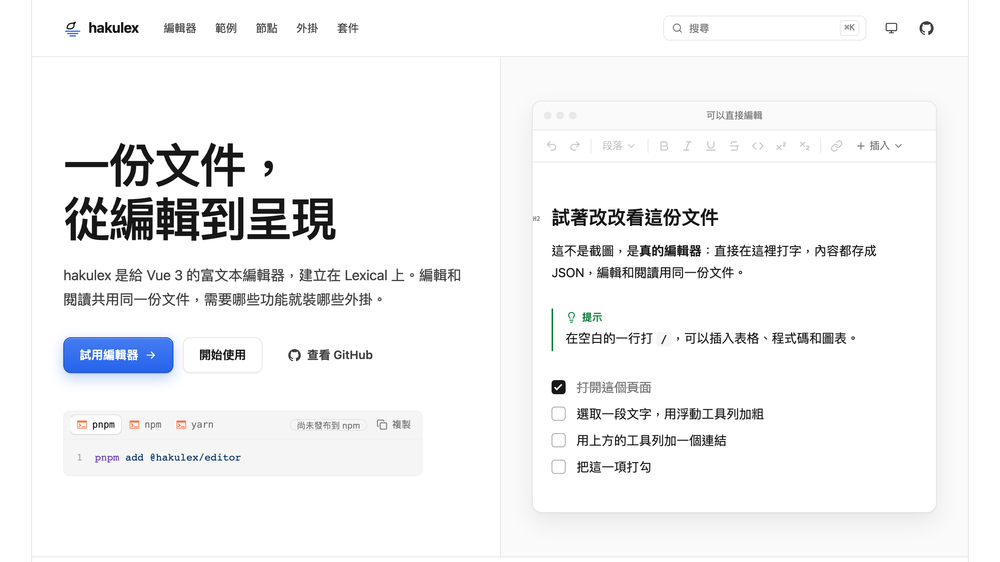

<h1>
  
  hakulex
</h1>

[](https://github.com/KennKyou/hakulex/actions/workflows/ci.yml)

A rich text editor for Vue 3, built on Lexical. One JSON document, from editing to reading.

**一份文件，從編輯到呈現。** hakulex 是給 Vue 3 的富文本編輯器，建立在 [Lexical](https://lexical.dev) 上。編輯和閱讀共用同一份 JSON 文件，需要哪些功能就裝哪些外掛。

**展示網站：[hakulex.dev](https://hakulex.dev)**，可以直接在瀏覽器裡試用編輯器，並看每一種節點、外掛和套件的範例。



## 特色

- **為 Vue 而寫**：不是把別的框架的元件包一層。用 `v-model` 綁定文件，用插槽放進工具列和外掛。
- **一份 JSON，兩種用途**：編輯器存下來的 JSON，閱讀頁直接呈現，也能在伺服器端輸出，不用載入編輯器。
- **只裝需要的**：工具列、斜線選單、表格操作都是各自獨立的套件，沒用到的不會進到你的網站。
- **內容豐富**：除了標題、清單、表格，還有程式碼區塊、數學式、Mermaid 圖表、圖表、投票、圖庫、嵌入等三十多種節點。
- **放心用在產品裡**：以 TypeScript 撰寫、附完整型別，有單元測試和三種瀏覽器的端對端測試。

## 快速開始

安裝編輯器，以及它需要的 `lexical` 和 `vue`：

```bash
pnpm add @hakulex/editor lexical vue
```

### 編輯

文件用 `v-model` 綁定，一開始可以是 `null`。樣式要自己引入一次，通常放在應用程式的進入點：`@hakulex/editor/style.css` 一個檔案就包含設計 token、內容排版和編輯器本身的樣式。

```vue
<script setup lang="ts">
import type { SerializedEditorState } from 'lexical'
import { RichEditor } from '@hakulex/editor'
import { shallowRef } from 'vue'
import '@hakulex/editor/style.css'

const doc = shallowRef<SerializedEditorState | null>(null)
</script>

<template>
  <RichEditor v-model="doc" placeholder="開始輸入…" />
</template>
```

這樣就有一個能打字、支援 Markdown 寫法（例如 `# 標題`、`**粗體**`）的編輯器。

### 加上外掛

外掛是放在 `RichEditor` 裡面的元件，要用哪個就裝哪個。有畫面的外掛各有自己的 `style.css`，用到的才引入：

```bash
pnpm add @hakulex/plugin-toolbar @hakulex/plugin-slash-menu
```

```vue
<script setup lang="ts">
import type { SerializedEditorState } from 'lexical'
import { RichEditor } from '@hakulex/editor'
import { SlashMenuPlugin } from '@hakulex/plugin-slash-menu'
import { ToolbarPlugin } from '@hakulex/plugin-toolbar'
import { shallowRef } from 'vue'
import '@hakulex/editor/style.css'
import '@hakulex/plugin-toolbar/style.css'
import '@hakulex/plugin-slash-menu/style.css'

const doc = shallowRef<SerializedEditorState | null>(null)
</script>

<template>
  <RichEditor v-model="doc" placeholder="開始輸入…">
    <template #toolbar>
      <ToolbarPlugin />
    </template>
    <SlashMenuPlugin />
  </RichEditor>
</template>
```

### 呈現

閱讀頁只需要 `@hakulex/renderer`，不必載入編輯器和 Lexical，也可以在伺服器端輸出。它的樣式在 `@hakulex/style-token`：

```bash
pnpm add @hakulex/renderer @hakulex/style-token vue
```

```vue
<script setup lang="ts">
import type { SerializedEditorState } from 'lexical'
import { RichRenderer } from '@hakulex/renderer'
import '@hakulex/style-token/style.css'

defineProps<{ doc: SerializedEditorState }>()
</script>

<template>
  <RichRenderer :value="doc" />
</template>
```

## 套件

### 核心

| 套件 | 說明 |
| --- | --- |
| `@hakulex/editor` | 編輯器本體 `<RichEditor>`。外掛都放在它裡面，文件用 `v-model` 綁定。 |
| `@hakulex/renderer` | `<RichRenderer>`：把文件 JSON 呈現成 Vue 元件，可以在伺服器端執行，不需要 Lexical。 |
| `@hakulex/style-token` | 設計 token、CSS 變數和各種排版的預設值，可以覆寫成自己的設計。 |
| `@hakulex/vue-lexical` | Lexical 的 Vue 3 綁定，想自己組編輯器時使用；一般直接用 `editor` 就好。 |

### 外掛

| 套件 | 說明 |
| --- | --- |
| `@hakulex/plugin-toolbar` | 固定在編輯器上方的工具列：復原、區塊樣式、文字格式、連結和插入選單。 |
| `@hakulex/plugin-floating-toolbar` | 選取文字時出現在選取範圍旁的格式工具列。 |
| `@hakulex/plugin-slash-menu` | 在空白處打 `/` 插入區塊，繼續打字可以篩選。 |
| `@hakulex/plugin-mention` | 打 `@` 提及社群平台上的帳號。 |
| `@hakulex/plugin-link-edit` | 游標在連結上時顯示面板，可以開啟、複製、修改和移除連結。 |
| `@hakulex/plugin-block-handle` | 區塊左側的把手，可以拖曳、移動、複製區塊或轉換類型。 |
| `@hakulex/plugin-table` | 表格的列和欄把手：增減、移動、對齊和調整欄寬。 |
| `@hakulex/plugin-image-editor` | 插入圖片前裁切、標註、打馬賽克和調整大小。標註使用 [marker.js](https://markerjs.com)，它的授權要求畫面上保留連回官網的連結（外掛已內建），否則需要購買商業授權。 |
| `@hakulex/plugin-litexml-paste` | 貼上 LiteXML 文字時變成對應的區塊，適合貼上 AI 產生的內容。 |
| `@hakulex/plugin-block-id` | 替每個最上層區塊加上不會變的編號，存在文件裡，給需要指出「哪一個區塊」的功能使用。 |

### 工具

| 套件 | 說明 |
| --- | --- |
| `@hakulex/diff` | 並排或單欄顯示兩個版本文件的差異。 |
| `@hakulex/diff-core` | 比對兩份文件的核心邏輯，例如算出字數和區塊的變更統計，不含畫面。 |
| `@hakulex/litexml` | 在文件 JSON 和 LiteXML 之間轉換；LiteXML 是給 AI 讀寫的精簡 XML 格式。 |
| `@hakulex/litexml-cli` | `litexml` 指令：在終端機把 LiteXML 或文件 JSON 轉成 HTML、JSON 或 Markdown。 |
| `@hakulex/headless` | 不需要瀏覽器就能讀取文件並轉成 Markdown，主要用在伺服器。 |
| `@hakulex/agent-core` | AI 協作的核心，不含畫面：模型怎麼看到文件、怎麼提出修改、修改怎麼逐項接受或拒絕，以及對話迴圈。不依賴 Vue。 |

## 開發

需要 Node.js 22.23.4 以上（建議 24）和 pnpm。

```bash
pnpm install
pnpm dev             # 展示網站：http://localhost:5199
pnpm build           # 建置 packages/*（ESM .mjs 和 .d.ts）
pnpm test            # 單元測試（Vitest）
pnpm test:e2e        # 端對端測試（Playwright，Chromium）
pnpm test:e2e:cross  # 端對端測試（Firefox 和 WebKit）
pnpm typecheck       # 每個套件各跑一次 vue-tsc
pnpm lint            # ESLint（@antfu/eslint-config）
```

展示網站有每個節點、外掛和套件的說明與可操作的範例，也是開發時用來試功能的地方。

push 到 `main` 和每個 PR 都會在 GitHub 上自動執行 `pnpm lint`、`pnpm typecheck`、`pnpm test`，並建置套件和展示網站。端對端測試不在其中，要在本機執行。

開發時，套件的 `exports` 指向 `src/`，所以展示網站會直接熱更新套件的原始碼，不用先建置；發布時 `publishConfig.exports` 會換成 `dist/`。

### 新增一種區塊

1. 在 `@hakulex/renderer` 寫呈現元件 `FooView`（要能在伺服器端執行，不能引入 `lexical`），並註冊到 `builtinRenderers`。
2. 在 `@hakulex/editor` 寫 `FooNode`（DecoratorNode）和它的編輯元件；編輯元件包住 `FooView`。
3. 把節點註冊到 `builtinNodes`；有 Markdown 寫法或斜線選單項目的話一併加上。
4. 擴充一致性測試的文件（`packages/editor/tests/parity.test.ts`）。

## 更新紀錄

每個版本改了什麼，見 [CHANGELOG.md](./CHANGELOG.md)。所有套件一起發布，用同一個版本號。

## 致謝

hakulex 沿用了 [haklex](https://github.com/Innei/haklex) 的文件格式、行為和視覺設計。haklex 是建立在 Lexical 上的 React 富文本編輯器，以 MIT 授權釋出。

編輯器、呈現元件、外掛的介面和 Vue 綁定是為 Vue 重新寫的；和框架無關的部分則改寫自 haklex 的原始碼，主要是 LiteXML（`litexml`、`litexml-cli`）、`headless`、文件比較（`diff-core`、`diff`）和圖片編輯（`plugin-image-editor`）的裁切、馬賽克與標註，以及它們的測試。

感謝 haklex 的作者 Innei 和所有貢獻者。完整的說明、版權聲明和授權條文見 [NOTICE](./NOTICE)。

## 授權

[MIT](./LICENSE)
